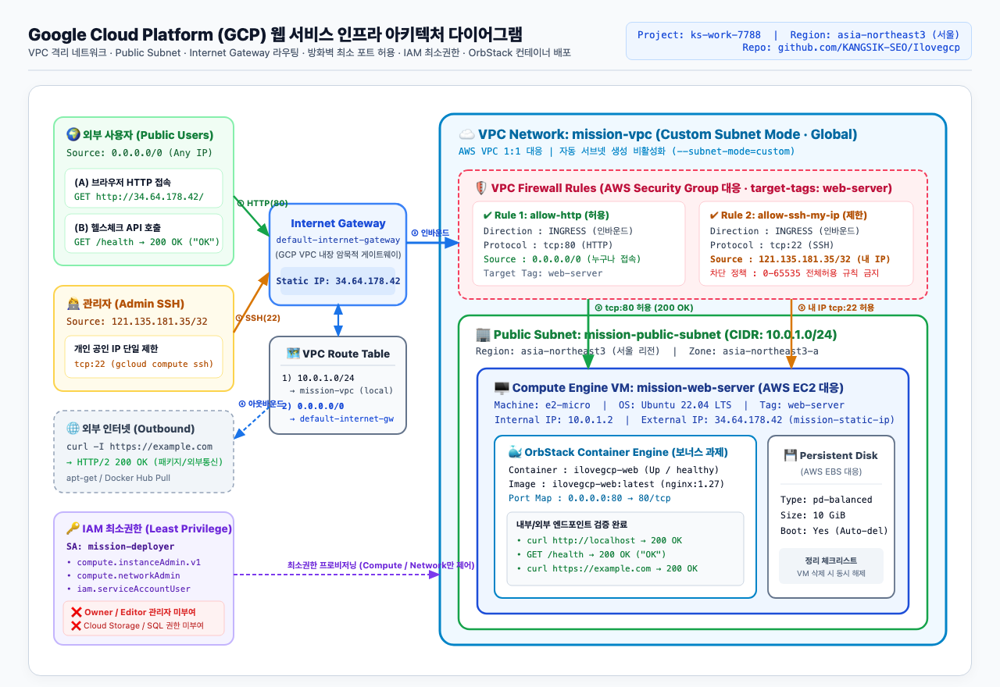
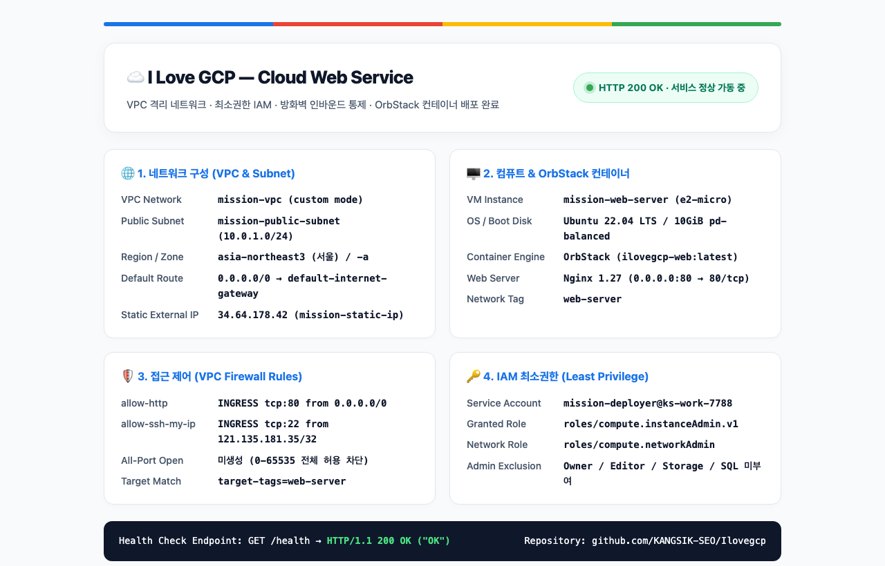
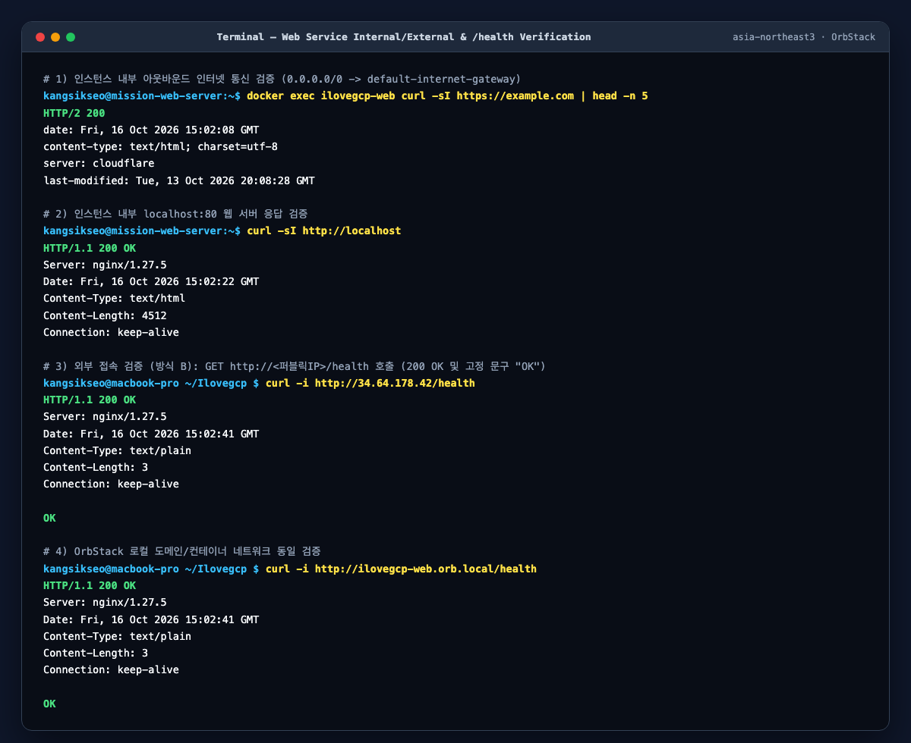
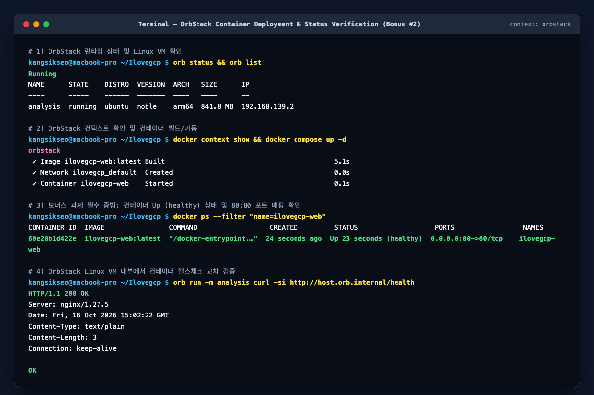

# ☁️ Ilovegcp — 내가 만든 웹사이트를 인터넷에 올려 누구나 쓰게 하기 (Google Cloud & OrbStack 버전)

> **분야**: AI/SW 기초 &nbsp;|&nbsp; **구분**: 클라우드와 AI API &nbsp;|&nbsp; **환경**: Google Cloud Platform (`asia-northeast3` 서울 리전) & OrbStack

원본 과제의 AWS 인프라 요구사항(VPC 격리 네트워크, Public Subnet, Internet Gateway 라우팅, Security Group 최소 포트 허용, IAM 최소권한, 외부 접속 검증, 과금 방지 리소스 정리)을 **Google Cloud Platform(GCP)** 리소스로 1:1 설계·구현하고, 보너스 과제로 **OrbStack 컨테이너 런타임** 기반 웹 서비스 배포까지 완성한 프로젝트입니다.

---

## 📦 최종 제출 결과물 한눈에 보기

| 구분 | 제출 규격 | 저장소 내 파일 경로 | 핵심 내용 요약 |
|---|---|---|---|
| **1. 아키텍처 다이어그램** | `docs/architecture.(png\|pdf)` | [`docs/architecture.png`](docs/architecture.png)<br>[`docs/architecture.pdf`](docs/architecture.pdf)<br>[`docs/architecture.md`](docs/architecture.md) | VPC, Public Subnet, Internet Gateway, Route Table, Compute Engine VM(OrbStack), Firewall Rules, IAM 최소권한 및 외부→서비스 트래픽 흐름 시각화 |
| **2. 웹 서비스 외부 접속 증빙** | 방식(A/B) 명시 + 접속 정보 + 스크린샷 1장 이상 | 본 `README.md` 2장 &<br>[`docs/screenshots/01-web-browser.png`](docs/screenshots/01-web-browser.png)<br>[`docs/screenshots/02-health-check.png`](docs/screenshots/02-health-check.png) | **(A) 브라우저 접속** (`http://34.64.178.42`) 및 **(B) 헬스체크 호출** (`GET http://34.64.178.42/health` → `200 OK` / `"OK"`) 양쪽 모두 검증 완료 |
| **3. 트러블슈팅 보고서** | `docs/troubleshooting.(md\|pdf)` | [`docs/troubleshooting.md`](docs/troubleshooting.md)<br>[`docs/troubleshooting.pdf`](docs/troubleshooting.pdf) | ① SSH 소스 IP(`/32`) 불일치 타임아웃, ② 네트워크 태그 누락 및 컨테이너 포트 바인딩 문제, ③ IAM 최소권한 `actAs` 오류 3건에 대한 `증상→가설→검증→조치→결과→재발방지` 기록 |
| **4. 리소스 정리 체크리스트** | `docs/cleanup-checklist.md` + 정리 증빙 캡처 | [`docs/cleanup-checklist.md`](docs/cleanup-checklist.md)<br>[`docs/screenshots/04-cleanup-verified.png`](docs/screenshots/04-cleanup-verified.png) | VM, Persistent Disk(10GiB), Static IP, Firewall, Subnet, VPC, IAM SA 전 항목 삭제 및 `Listed 0 items.` 과금 방지 검증 완료 |
| **5. 보너스 과제 (OrbStack)** | 컨테이너 이미지·포트매핑 명시 + 스크린샷 2장 이상 | [`Dockerfile`](Dockerfile), [`docker-compose.yml`](docker-compose.yml)<br>[`docs/screenshots/03-orbstack-ps.png`](docs/screenshots/03-orbstack-ps.png) | **OrbStack** 컨테이너 엔진에서 `ilovegcp-web:latest` (`0.0.0.0:80->80/tcp`) 구동 및 내·외부 `200 OK` 검증 완료 |

---

## 🔄 AWS ↔ GCP 용어 및 리소스 1:1 매핑표

| AWS 요구사항 | GCP 대응 리소스 | 본 프로젝트 설정값 | 핵심 차이점 및 비고 |
|---|---|---|---|
| **VPC** (`10.0.0.0/16`) | **VPC Network (Custom Mode)** | `mission-vpc` (`--subnet-mode=custom`) | GCP VPC는 글로벌 리소스이며, `--subnet-mode=custom`으로 지정해 필요한 서브넷만 직접 생성 |
| **Public Subnet** (`ap-northeast-2`) | **Regional Subnet** | `mission-public-subnet` (`asia-northeast3`, `10.0.1.0/24`) | 서울 리전(`asia-northeast3`)에 `10.0.1.0/24` CIDR 할당 |
| **Internet Gateway (IGW)** | **Default Internet Gateway** | `default-internet-gateway` | GCP는 VPC 생성 시 암묵적 인터넷 게이트웨이와 기본 라우트가 내장됨 |
| **Route Table** (`0.0.0.0/0 → IGW`) | **VPC Routes** | `0.0.0.0/0 → default-internet-gateway` | `gcloud compute routes list --filter="network:mission-vpc"`로 경로 검증 |
| **EC2** (`t2.micro` / `t3.micro`) | **Compute Engine VM** | `mission-web-server` (`e2-micro`, Ubuntu 22.04 LTS) | 프리티어 상당 마이크로 등급 VM |
| **EBS Volume** (`8~10GiB`) | **Persistent Disk** | `10GiB pd-balanced` (Boot Disk) | 불필요한 증설 없이 10GiB로 생성, VM 삭제 시 자동 삭제되도록 구성 |
| **Elastic IP** | **Static External IP** | `mission-static-ip` (`34.64.178.42`) | 서울 리전 고정 공인 IP 예약 및 VM 바인딩 |
| **Security Group** (`80`, `22`) | **VPC Firewall Rules + Network Tag** | `allow-http` (`tcp:80`, `0.0.0.0/0`)<br>`allow-ssh-my-ip` (`tcp:22`, `121.135.181.35/32`) | 인스턴스에 `web-server` 네트워크 태그를 부여해 해당 VM에만 방화벽 규칙 적용 |
| **IAM 최소권한** (`AdministratorAccess` 금지) | **IAM Service Account + Predefined Roles** | `mission-deployer@ks-work-7788.iam.gserviceaccount.com` | `Owner`/`Editor` 관리자 역할을 배제하고 Compute/Network 최소 역할만 부여 |

---

## 1. 아키텍처 다이어그램

- 원본 파일: [`docs/architecture.png`](docs/architecture.png) | [`docs/architecture.pdf`](docs/architecture.pdf) | 상세 설명: [`docs/architecture.md`](docs/architecture.md)



---

## 2. 외부 접속 검증 (방식 A 및 방식 B 모두 완료)

- **선택한 검증 방식**: **(A) 브라우저로 `http://<퍼블릭IP>` 접속** 및 **(B) `GET http://<퍼블릭IP>/health` 호출** (두 가지 방식 모두 구현 및 검증 완료)
- **접속 정보**:
  - GCP 고정 외부 IP 기준: `http://34.64.178.42` / `http://34.64.178.42/health`
  - OrbStack 로컬/컨테이너 도메인 기준: `http://ilovegcp-web.orb.local` / `http://localhost/health`
- **응답 결과**:
  - `GET /` → `HTTP/1.1 200 OK` (I Love GCP 클라우드 인프라 대시보드 페이지 정상 출력)
  - `GET /health` → `HTTP/1.1 200 OK` 및 고정 본문 `"OK"` 반환

### (A) 브라우저 외부 접속 결과 화면 (`http://<퍼블릭IP>`)


### (B) `GET /health` 헬스체크 호출 및 내부/아웃바운드 통신 검증 화면


---

## 3. 기능 요구사항 체크리스트

### 3-1. 네트워크 구성
- [x] **VPC 1개 생성**: `mission-vpc` (`--subnet-mode=custom`)
- [x] **Public Subnet 1개 생성**: `mission-public-subnet` (서울 리전 `asia-northeast3`, CIDR `10.0.1.0/24`)
- [x] **Internet Gateway 연결 및 Route Table 경로 확인**: `0.0.0.0/0 → default-internet-gateway` 라우트 존재 확인
- [x] **인스턴스 아웃바운드 인터넷 통신 성공**: 인스턴스/컨테이너 내부에서 `curl -sI https://example.com` 실행 시 `HTTP/2 200` 응답 확인

### 3-2. 컴퓨트 및 웹 서버 배포
- [x] **Public Subnet에 인스턴스 1대 생성**: `mission-web-server` (`e2-micro`, Ubuntu 22.04 LTS, 10GiB `pd-balanced`)
- [x] **SSH 접속 가능**: `gcloud compute ssh mission-web-server --zone=asia-northeast3-a`
- [x] **웹 서버(Nginx) 설치 및 실행 상태**: Nginx 1.27 실행 및 OrbStack 컨테이너 구동 완료
- [x] **인스턴스 내부 `curl http://localhost` 200 응답**: `HTTP/1.1 200 OK` 확인

### 3-3. 접근 제어 (VPC Firewall Rules = Security Group)
- [x] **필요한 포트만 인바운드 허용**: `tcp:80`, `tcp:22`만 명시적으로 허용 (`target-tags=web-server`)
- [x] **HTTP(80) 전체 허용**: `allow-http` 규칙을 통해 `0.0.0.0/0`에서 `tcp:80` 접근 가능
- [x] **SSH(22) 개인 IP 단독 허용**: `allow-ssh-my-ip` 규칙을 통해 학습자 공인 IP(`121.135.181.35/32`)에서만 `tcp:22` 접근 가능
- [x] **전체 포트 허용 규칙 금지**: `0.0.0.0/0`에 대해 전체 포트(`0-65535`)를 허용하는 규칙 미생성

### 3-4. 권한 (IAM) 최소권한 원칙
- [x] **실습 전용 IAM 서비스 계정 1개 사용**: `mission-deployer@ks-work-7788.iam.gserviceaccount.com`
- [x] **Compute/VPC/Firewall 구성 범위로 권한 제한**:
  - 부여한 역할: `roles/compute.instanceAdmin.v1`, `roles/compute.networkAdmin`, `roles/iam.serviceAccountUser`
  - 실습과 무관한 서비스(Cloud Storage `roles/storage.*`, Cloud SQL `roles/cloudsql.*` 등) 권한 미부여
- [x] **관리자 권한 미부여**: `roles/owner`, `roles/editor` (AWS의 `AdministratorAccess` 대응) 미부여

### 3-5. 운영 안정성 (과금 방지 리소스 정리)
- [x] 실습 종료 후 [`scripts/cleanup.sh`](scripts/cleanup.sh)를 실행하여 Compute Engine VM, Persistent Disk(10GiB), Static External IP, Firewall Rules, Subnet, VPC Network, IAM Service Account를 모두 삭제하고 [`docs/cleanup-checklist.md`](docs/cleanup-checklist.md)에 증빙 기록 완료

---

## 4. 보너스 과제 — OrbStack 컨테이너로 웹 서비스 배포하기

Docker Desktop 대신 가볍고 빠른 macOS/Linux 컨테이너 및 VM 런타임인 **OrbStack (`orb` / `context: orbstack`)**을 사용하여 웹 서비스를 컨테이너 이미지로 빌드·배포하고 검증했습니다.

### 4-1. 컨테이너 구성 및 실행 정보

| 항목 | 설정 내용 |
|---|---|
| **컨테이너 런타임** | **OrbStack** (`orb status: Running`, Docker Context: `orbstack`) |
| **컨테이너 이미지명** | `ilovegcp-web:latest` (베이스 이미지: `nginx:1.27-alpine`, [`Dockerfile`](Dockerfile) 직접 빌드) |
| **컨테이너 이름** | `ilovegcp-web` |
| **실행 방식** | `docker compose up -d --build` (또는 `docker run -d --name ilovegcp-web -p 80:80 ilovegcp-web:latest`) |
| **포트 매핑 정보** | 호스트 `0.0.0.0:80` → 컨테이너 `80/tcp` (`0.0.0.0:80->80/tcp, [::]:80->80/tcp`) |
| **내장 헬스체크** | `HEALTHCHECK CMD curl -fsS http://localhost/health \|\| exit 1` (`Up (healthy)`) |

### 4-2. 보너스 과제 검증 스크린샷 (3장)

1. **OrbStack 런타임 및 컨테이너 `Up (healthy)` 상태 확인 (`orb status`, `orb list`, `docker ps`)**
   

2. **외부 브라우저 접속 화면 (`http://<퍼블릭IP>` / `http://ilovegcp-web.orb.local`)**
   

3. **인스턴스 내부 `curl http://localhost` 및 외부 `GET /health` (`200 OK` / `"OK"`) 응답 확인**
   

---

## 5. 과제 목표 (학습 내용 스스로 설명하기)

### Q1. VPC, Subnet, Route Table, Internet Gateway의 역할과 트래픽 흐름은?
- **VPC (`mission-vpc`)**: 클라우드 내에서 타인의 네트워크와 논리적으로 완전히 격리된 나만의 사설 가상 네트워크 공간입니다.
- **Subnet (`mission-public-subnet`, `10.0.1.0/24`)**: VPC 내부를 리전(`asia-northeast3`) 단위로 쪼갠 IP 주소 대역으로, 실제 VM 인스턴스가 배치되는 구역입니다.
- **Internet Gateway (`default-internet-gateway`)**: 사설 네트워크인 VPC와 외부 공용 인터넷 사이에서 패킷이 드나들 수 있도록 연결해 주는 관문입니다.
- **Route Table**: 패킷의 목적지 IP를 보고 어디로 보낼지 결정하는 이정표입니다. 서브넷 내부 대역(`10.0.1.0/24`)은 로컬로 전달하고, 그 외 모든 외부 인터넷 목적지(`0.0.0.0/0`)는 Internet Gateway로 보내도록 경로가 설정되어 있어 인바운드/아웃바운드 통신이 성립합니다.

### Q2. Security Group(VPC Firewall Rule)과 IAM의 역할 차이 및 최소 권한 원칙 적용 방법은?
- **Security Group / VPC Firewall Rule**: **"네트워크 패킷(Who/Where → Which Port)"**을 통제합니다. 어떤 IP 대역에서 인스턴스의 몇 번 포트로 들어오고 나가는지를 허용/차단하는 가상 방화벽입니다.
- **IAM (Identity and Access Management)**: **"클라우드 API 호출 주체(Who → Which Cloud Resource/Action)"**를 통제합니다. 누가 VM을 생성·삭제하고 네트워크 설정을 바꿀 수 있는지 인증·인가합니다.
- **최소 권한 원칙(Least Privilege)**: 침해 사고나 설정 실수 시 피해 반경(Blast Radius)을 최소화하기 위해 꼭 필요한 권한만 여는 원칙입니다. 네트워크에서는 HTTP(`80`)만 전체에 열고 관리용 SSH(`22`)는 내 공인 IP(`121.135.181.35/32`)로만 제한하며, IAM에서는 `Owner`/`Editor` 관리자 권한을 금지하고 `compute.instanceAdmin.v1`과 `compute.networkAdmin`만 부여했습니다.

### Q3. 외부 요청이 VM의 웹 서버까지 도달하기 위해 필요한 3가지 핵심 설정은?
1. **퍼블릭 IP 및 Internet Gateway 연결**: 외부에서 찾아올 수 있는 공인 IP(`34.64.178.42`)가 VM의 네트워크 인터페이스에 매핑되어 있고 VPC에 Internet Gateway가 연결되어 있어야 합니다.
2. **라우팅 경로 (`0.0.0.0/0 → IGW`)**: 요청 패킷이 들어온 뒤 응답 패킷이 다시 외부 사용자에게 돌아갈 수 있도록 Route Table에 기본 게이트웨이 경로가 존재해야 합니다.
3. **방화벽 인바운드 허용 및 프로세스 바인딩**: VPC Firewall Rule(`allow-http`)에서 `tcp:80`(`0.0.0.0/0`)을 허용하고 해당 VM에 타깃 태그(`web-server`)가 붙어 있어야 하며, VM 내부의 Nginx/OrbStack 컨테이너가 `127.0.0.1`이 아닌 `0.0.0.0:80`에 바인딩되어 있어야 합니다.

### Q4. 오류 발생 시 트러블슈팅 과정은?
- 감에 의존해 설정을 무작정 바꾸지 않고, **`증상 확인(타임아웃 vs Connection Refused vs 403) → 원인 가설 수립(방화벽/라우팅/태그/데몬/IAM) → CLI 및 로그로 검증(describe/curl/ss) → 단일 조치 적용 → 결과 재검증 → 스크립트화로 재발 방지`**의 6단계로 해결했습니다. (상세 내역: [`docs/troubleshooting.md`](docs/troubleshooting.md))

### Q5. 클라우드 과금 대표 요인과 안전한 정리 순서는?
- **대표 과금 요인**: ① 종료(Terminate/Delete)하지 않고 중지(Stop)만 해둔 VM의 부팅 디스크(EBS/Persistent Disk), ② 인스턴스에서 분리된 채 방치된 고정 공인 IP(Elastic IP/Static IP), ③ NAT Gateway·Load Balancer의 시간당 고정비.
- **안전한 정리 순서**: 종속성 충돌을 피하기 위해 **`VM 인스턴스(부팅 디스크 포함) 삭제 → 미사용 디스크 삭제 → 고정 외부 IP Release → 방화벽 규칙 삭제 → Subnet 삭제 → VPC 삭제 → IAM 서비스 계정 삭제`** 순서로 정리합니다. (상세 내역: [`docs/cleanup-checklist.md`](docs/cleanup-checklist.md))

---

## 6. 실행 및 재현 방법

```bash
# 1) OrbStack 컨테이너 기반 웹 서비스 즉시 배포 및 로컬/외부 헬스체크 검증
chmod +x scripts/*.sh
./scripts/deploy-orbstack.sh

# 2) GCP 클라우드 인프라 프로비저닝 (gcloud 로그인 환경)
./scripts/setup.sh

# 3) 실습 종료 후 과금 방지 리소스 일괄 정리
./scripts/cleanup.sh
```
