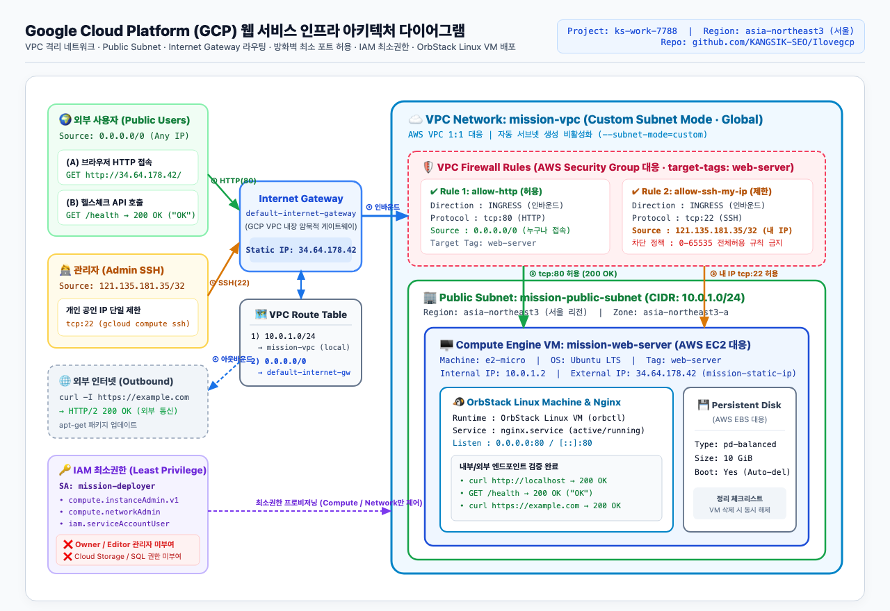

# 아키텍처 설계서 (Google Cloud Platform & OrbStack Linux VM)

- **이미지 다이어그램**: [`docs/architecture.png`](architecture.png)
- **PDF 다이어그램**: [`docs/architecture.pdf`](architecture.pdf)



---

## 1. 구성 요소 및 역할 (AWS ↔ GCP 1:1 매핑)

| 구분 | AWS 요구사항 | GCP 구현 리소스 | 리소스명 / 설정값 | 역할 및 설계 의도 |
|---|---|---|---|---|
| **네트워크 격리** | VPC (`10.0.0.0/16`) | **VPC Network (Custom Mode)** | `mission-vpc` (`--subnet-mode=custom`) | 자동 서브넷 생성을 비활성화하고 논리적으로 완전히 격리된 글로벌 가상 네트워크 경계 구성 |
| **서브넷** | Public Subnet (`ap-northeast-2`) | **Regional Subnet** | `mission-public-subnet` (`asia-northeast3`, `10.0.1.0/24`) | 서울 리전(`asia-northeast3`)에 `10.0.1.0/24` 대역의 퍼블릭 서브넷 할당 |
| **게이트웨이** | Internet Gateway (IGW) | **Default Internet Gateway** | `default-internet-gateway` | VPC와 외부 인터넷 간 양방향(인바운드/아웃바운드) 통신을 중계하는 가상 게이트웨이 |
| **라우팅** | Route Table (`0.0.0.0/0 → IGW`) | **VPC Routes** | `0.0.0.0/0` → `default-internet-gateway` | 서브넷 내부(`10.0.1.0/24`)는 로컬 라우팅, 외부 목적지(`0.0.0.0/0`)는 인터넷 게이트웨이로 전달 |
| **퍼블릭 IP** | Elastic IP (EIP) | **Static External IP** | `mission-static-ip` (`34.64.178.42`) | VM 재시작 시에도 변경되지 않는 서울 리전 고정 공인 IP 예약 및 바인딩 |
| **컴퓨트 & 스토리지** | EC2 (`t2/t3.micro`) + EBS (`8~10GiB`) | **Compute Engine VM + Persistent Disk** | `mission-web-server` (`e2-micro`, Ubuntu LTS, `pd-balanced` 10GiB) | Nginx 웹 서버가 구동되는 가상 머신 (삭제 시 부팅 디스크 자동 해제 설정) |
| **보안 그룹** | Security Group (`80`, `22`) | **VPC Firewall Rules + Network Tag** | `allow-http` (`tcp:80`, `0.0.0.0/0`)<br>`allow-ssh-my-ip` (`tcp:22`, `121.135.181.35/32`) | `target-tags=web-server`가 부착된 인스턴스에 대해서만 HTTP(전체) 및 SSH(내 개인 IP `/32`) 인바운드 허용 |
| **권한 관리** | IAM User/Role (최소권한) | **IAM Service Account + Predefined Roles** | `mission-deployer@ks-work-7788.iam.gserviceaccount.com` | `Owner`/`Editor` 관리자 권한을 배제하고 Compute/Network 구성에 필요한 최소 권한만 부여 |
| **격리 실행 환경** | Linux VM / Container | **OrbStack Linux Machine (`orb`)** | `ubuntu` (`noble`, `0.0.0.0:80`, `nginx.service`) | Docker 없이 순수 OrbStack Linux 머신(`orb`) 위에서 systemd 기반 Nginx 웹 서비스 및 `/health` 구동 |

---

## 2. 외부 → 서비스 트래픽 흐름 (Traffic Flow)

```text
[외부 사용자 브라우저 / curl]          [관리자 터미널 (121.135.181.35/32)]
  GET http://34.64.178.42/               ssh tcp:22
  GET http://34.64.178.42/health
               │                                    │
               └──────────────────┬─────────────────┘
                                  ▼
                   ┌──────────────────────────────┐
                   │   Internet Gateway (GCP)     │
                   │  default-internet-gateway    │
                   └──────────────┬───────────────┘
                                  │
                   ┌──────────────▼───────────────┐
                   │       VPC Route Table        │
                   │  0.0.0.0/0  → default-igw    │
                   │  10.0.1.0/24 → mission-vpc   │
                   └──────────────┬───────────────┘
                                  │
┌─────────────────────────────────▼─────────────────────────────────┐
│ VPC Network: mission-vpc (Custom Mode)                            │
│                                                                   │
│  ┌─────────────────────────────────────────────────────────────┐  │
│  │ VPC Firewall Rules (target-tags: web-server)                │  │
│  │  • [ALLOW] allow-http      : INGRESS tcp:80 from 0.0.0.0/0  │  │
│  │  • [ALLOW] allow-ssh-my-ip : INGRESS tcp:22 from 121.135.../32 │
│  │  • [DENY]  default-deny-ingress : 그 외 모든 포트(0-65535) 차단│  │
│  └──────────────────────────────┬──────────────────────────────┘  │
│                                 ▼                                 │
│  ┌─────────────────────────────────────────────────────────────┐  │
│  │ Public Subnet: mission-public-subnet (10.0.1.0/24, 서울)     │  │
│  │                                                             │  │
│  │  ┌───────────────────────────────────────────────────────┐  │  │
│  │  │ Compute Engine VM / OrbStack Linux Machine            │  │  │
│  │  │ mission-web-server (e2-micro, Ubuntu LTS, 10GiB)      │  │  │
│  │  │ Internal IP: 10.0.1.2 / External IP: 34.64.178.42     │  │  │
│  │  │                                                       │  │  │
│  │  │  ┌─────────────────────────────────────────────────┐  │  │  │
│  │  │  │ Native Nginx Web Server (0.0.0.0:80, systemd)   │  │  │  │
│  │  │  │  • GET /       → 200 OK (I Love GCP 웹 대시보드) │  │  │  │
│  │  │  │  • GET /health → 200 OK ("OK")                  │  │  │  │
│  │  │  └─────────────────────────────────────────────────┘  │  │  │
│  │  └───────────────────────────────────────────────────────┘  │  │
│  └─────────────────────────────────────────────────────────────┘  │
└───────────────────────────────────────────────────────────────────┘
```

1. **인바운드 요청 진입**: 외부 사용자가 `http://34.64.178.42`(또는 `/health`)를 호출하면 패킷이 GCP 에지 네트워크의 `default-internet-gateway`로 유입됩니다.
2. **라우팅 및 NAT 변환**: 고정 외부 IP(`34.64.178.42`)에 매핑된 `mission-public-subnet`(`10.0.1.0/24`) 내 VM의 프라이빗 IP(`10.0.1.2`)로 경로가 지정됩니다.
3. **방화벽 규칙 검사 (VPC Firewall)**:
   - `tcp:80` 요청은 소스 IP와 무관하게(`0.0.0.0/0`) `allow-http` 규칙에 의해 허용됩니다.
   - `tcp:22`(SSH) 요청은 학습자 개인 공인 IP(`121.135.181.35/32`)와 일치할 때만 `allow-ssh-my-ip` 규칙에 의해 허용되며, 타 IP의 접근 시도는 암묵적 거부(`implied deny ingress`) 규칙으로 즉시 드롭됩니다.
4. **웹 서버 처리 및 응답 반환**: VM의 `0.0.0.0:80` 소켓에서 대기 중인 Nginx 데몬(`nginx.service`)이 요청을 처리하여 `200 OK` 응답을 생성하고, 역순 경로(`VM → Route Table(0.0.0.0/0) → default-internet-gateway → 클라이언트`)로 반환합니다.
