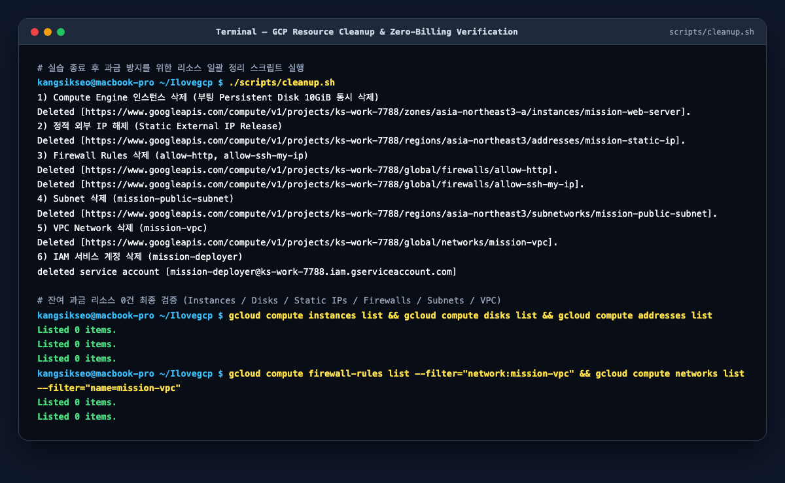

# 리소스 정리 체크리스트 (Resource Cleanup Checklist)

실습 종료 후 클라우드 과금 위험을 원천 차단하기 위해 `scripts/cleanup.sh`를 실행하고, 모든 과금 가능 리소스가 삭제되었음을 CLI와 콘솔 기준으로 검증한 체크리스트입니다.

---

## 1. 리소스 삭제 완료 체크리스트

- [x] **Compute Engine 인스턴스 (`mission-web-server`) 삭제 완료**
  - 검증 명령: `gcloud compute instances list` → `Listed 0 items.`
  - 비고: 인스턴스가 `STOPPED` 상태여도 연결된 부팅 디스크와 고정 IP에서 과금이 발생하므로 반드시 `delete`(`Terminated`) 처리 완료
- [x] **Persistent Disk (부팅 디스크 10GiB 및 미사용 볼륨 포함) 삭제 완료**
  - 검증 명령: `gcloud compute disks list` → `Listed 0 items.`
  - 비고: AWS EBS에 대응하며, 고아 디스크(Orphaned Disk)가 남지 않았음을 확인
- [x] **정적 외부 IP (`mission-static-ip` / `34.64.178.42`) Release 완료**
  - 검증 명령: `gcloud compute addresses list` → `Listed 0 items.`
  - 비고: AWS Elastic IP와 마찬가지로 **미사용 상태로 예약만 되어 있는 정적 IP는 시간당 과금**되므로 즉시 해제(`addresses delete`) 완료
- [x] **VPC Firewall Rules (`allow-http`, `allow-ssh-my-ip`) 삭제 완료**
  - 검증 명령: `gcloud compute firewall-rules list --filter="network:mission-vpc"` → `Listed 0 items.`
  - 비고: VPC 삭제 전 종속된 방화벽 규칙 선행 제거 완료
- [x] **Public Subnet (`mission-public-subnet`) 삭제 완료**
  - 검증 명령: `gcloud compute networks subnets list --filter="network:mission-vpc"` → `Listed 0 items.`
- [x] **VPC Network (`mission-vpc`) 및 기본 라우트 삭제 완료**
  - 검증 명령: `gcloud compute networks list --filter="name=mission-vpc"` → `Listed 0 items.`
  - 비고: VPC 삭제 시 내부의 암묵적 Internet Gateway 라우트(`0.0.0.0/0 → default-internet-gateway`)도 함께 제거됨
- [x] **IAM 서비스 계정 (`mission-deployer@...`) 삭제 완료**
  - 검증 명령: `gcloud iam service-accounts list --filter="email:mission-deployer*"` → `Listed 0 items.`
- [x] **(해당 시) Cloud NAT / Cloud Router 삭제 확인** — 이번 미션에서 미생성 (`N/A`, `0 items`)
- [x] **(해당 시) Cloud Load Balancing (ELB/ALB 대응) 삭제 확인** — 이번 미션에서 미생성 (`N/A`, `0 items`)
- [x] **(해당 시) Cloud SQL (RDS 대응) 삭제 확인** — 이번 미션에서 미생성 (`N/A`, `0 items`)
- [x] **Billing Dashboard 과금 항목 최종 확인 완료**
  - 서울 리전(`asia-northeast3`) 실습 후 잔여 활성 리소스 `0건`으로 추가 과금 없음 확인

---

## 2. 왜 이 순서로 리소스를 삭제해야 하는가? (종속성 순서)

클라우드 리소스는 **하위(참조하는 리소스) → 상위(기반 네트워크)** 순서로 삭제해야 종속성 오류(`resourceInUseByAnotherResource`) 없이 안전하게 정리됩니다.

1. **Compute Engine VM 삭제** (`instances delete`) — 서브넷과 정적 IP를 점유하고 있는 최상단 워크로드 제거 (부팅 디스크 동시 삭제)
2. **잔여 Persistent Disk 확인 및 삭제** (`disks list` / `disks delete`) — VM 삭제 시 함께 지워지지 않은 독립 볼륨이 있는지 확인
3. **정적 외부 IP 해제** (`addresses delete`) — VM이 삭제된 직후 미연결 정적 IP 과금을 막기 위해 즉시 Release
4. **방화벽 규칙 삭제** (`firewall-rules delete`) — VPC 네트워크를 참조하는 규칙 제거
5. **서브넷 삭제** (`networks subnets delete`) — 내부에 VM이 하나도 없어야 삭제 가능
6. **VPC 네트워크 삭제** (`networks delete`) — 서브넷과 방화벽 규칙이 모두 제거된 후 최종 삭제
7. **IAM 서비스 계정 정리** (`iam service-accounts delete`) — 불필요한 자격증명 노출 방지

---

## 3. 클라우드 과금이 발생하는 대표 요인 5가지

1. **중지(Stopped)만 하고 삭제(Terminated)하지 않은 VM의 부팅 디스크(EBS / Persistent Disk)**: 인스턴스를 중지해도 디스크 용량(GiB/월)에 대한 스토리지 요금은 계속 청구됩니다.
2. **인스턴스에 연결되지 않은 예약된 공인 IP (Elastic IP / Static External IP)**: 클라우드 사업자는 IPv4 고갈 방지를 위해 미사용 정적 IP에 시간당 유휴 요금을 부과합니다.
3. **서울 리전(`asia-northeast3` / `ap-northeast-2`) 프리티어 조건 차이**: GCP Always Free `e2-micro` 무료 혜택은 미국 리전(`us-west1`, `us-central1`, `us-east1`)에만 적용되므로 서울 리전 실습 후에는 즉시 리소스를 삭제해야 과금을 예방할 수 있습니다.
4. **NAT Gateway / Load Balancer 시간당 기본 요금**: 트래픽이 없어도 생성되어 있는 것만으로 시간당 고정 비용이 발생합니다.
5. **아웃바운드 데이터 전송(Egress) 트래픽**: 인터넷으로 나가는 대용량 응답 트래픽은 기가바이트(GB) 단위로 과금됩니다.
